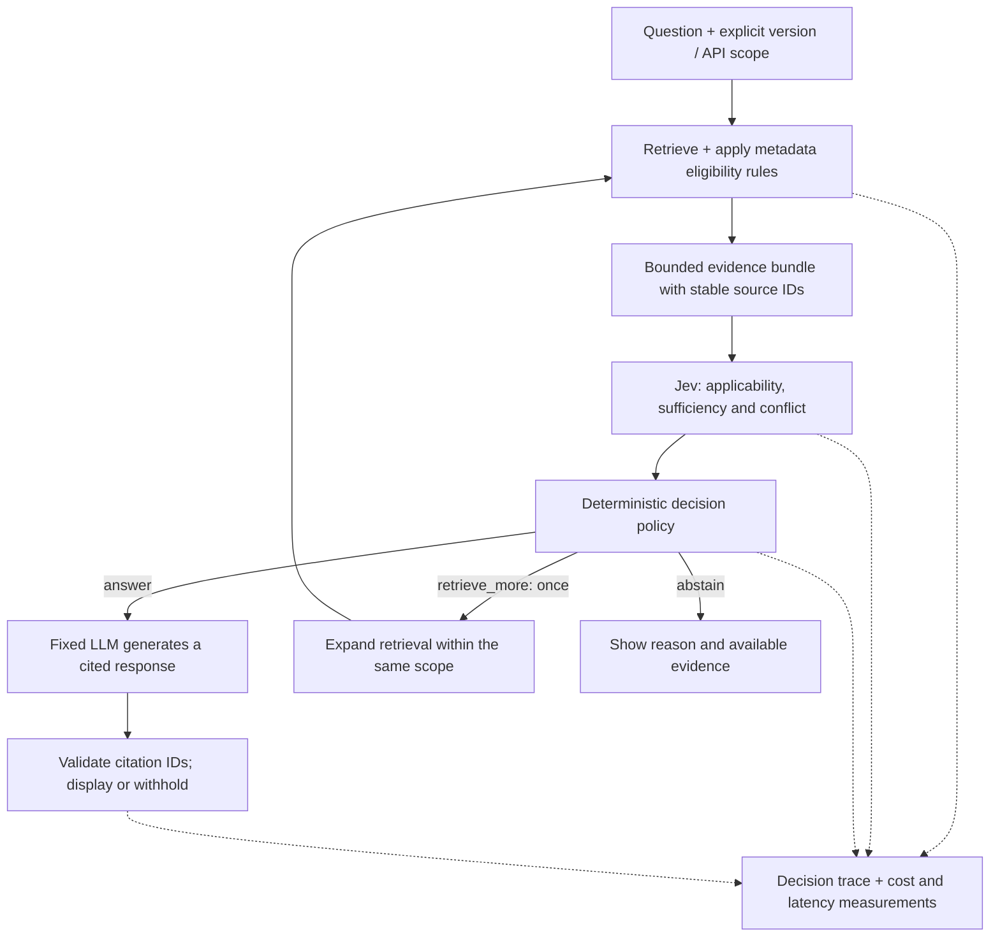

# EvidenceScope

**An evidence gate for RAG assistants answering questions about versioned software.**

EvidenceScope is a planned Python library and reference application that combines deterministic version rules with [TypeSafe AI's Jev](https://typesafe.ai/blog/introducing-system-one-models-and-jev) to decide when retrieved documentation supports an answer, when to retrieve more, and when to abstain.

> **Status: design and initial scaffold · September 26, 2026.**
> This repository contains the project design and empty implementation directories. The library, application, corpus and benchmark are not implemented yet. No performance results are claimed.

[Architecture](docs/architecture.md) · [Evaluation plan](docs/evaluation.md) · [Roadmap](docs/roadmap.md) · [Contributing](CONTRIBUTING.md)

## The problem

A retrieved page can be relevant and still describe the wrong version. A migration guide can discuss several versions on the same page. Two passages can appear contradictory while describing different conditions. A real citation can fail to support the answer attached to it.

EvidenceScope will make these evidence decisions visible before an assistant generates its response.

The first reference use case is technical support over pinned Pydantic V1 and V2 documentation. For example:

> In Pydantic V2's native API, can I omit a field annotated `Optional[str]` if it has no default?

The [Pydantic migration guide](https://pydantic.dev/docs/validation/latest/get-started/migration/) documents changes that make version context material to this question. The planned inspector will show the retrieved passages, scope exclusions, model judgments and resulting route.

## Three routes, explicit responsibilities

| Route | Intended behavior |
| --- | --- |
| `answer` | The evidence is eligible for a separate model to attempt a cited answer. |
| `retrieve_more` | Expand retrieval once, within the same requested version and a fixed evidence budget. |
| `abstain` | Explain a missing scope, unresolved conflict, insufficient evidence or unavailable decision service. |

An `answer` decision is permission to generate, not a guarantee that the generated answer will be correct. Final-answer correctness and citation support will be measured separately.

Code will enforce version eligibility, evidence identifiers, budgets and routing. Jev will judge narrow semantic questions about the supplied evidence. A conventional LLM will generate the final answer. Human-reviewed cases will provide evaluation labels.

## Planned architecture



The design starts with six evidence passages and at most one recovery retrieval. If the evidence bundle changes after a sufficiency judgment, it must be assessed again before generation. See the [architecture document](docs/architecture.md) for policy boundaries and failure behavior.

## What version one will include

- A Python package accepting a question, explicit version/API scope and caller-supplied evidence passages.
- A local documentation assistant using pinned, attributed source snapshots.
- A Streamlit inspector for candidates, exclusions, judgments, routes and cited responses.
- A benchmark CLI comparing deterministic rules, an inexpensive structured-output LLM and Jev.
- Recorded replay, meaningful tests and CI that does not require paid API access.
- Reproducible measurements and published failure cases.

The proposed stack is Python, Pydantic, the official [TypeSafe Python SDK](https://github.com/typesafe-ai/typesafe-sdk-python), SQLite FTS5 and Streamlit. Dependency versions will be selected and locked during the feasibility milestone.

## The experiment

**Does Jev improve evidence decisions beyond version filtering while preserving useful answer coverage?**

The planned comparison holds the corpus and answer-generating model constant:

| Approach | Question it answers |
| --- | --- |
| Retrieval + generation | How does an ordinary documentation assistant perform? |
| Metadata filtering + retrieval + generation | What can deterministic scope handling solve? |
| Same system + an inexpensive structured-output LLM gate | How does a conventional semantic judge perform? |
| Same system + the Jev gate | What does Jev contribute? |

The initial evaluation target is approximately 150 manually checked cases with topic-grouped development, calibration and test splits. Report unsupported and wrong-version answers, useful answer coverage, unnecessary abstention, recovery success, latency and total cost. Evaluate gate decisions on frozen evidence bundles, then evaluate the complete assistant separately.

Results will include uncertainty and failures. Abstaining on every question is not a successful outcome. The [evaluation plan](docs/evaluation.md) describes the comparisons and reporting requirements.

## Repository layout

Directories containing `.gitkeep` are intentionally empty in this initial commit.

```text
evidence-scope/
├── src/evidence_scope/      # Python library
├── apps/                   # Evidence inspector and reference assistant
├── examples/               # Integration examples
├── corpus/
│   ├── manifests/          # Source revisions, attribution and hashes
│   └── snapshots/          # Locally prepared documentation snapshots
├── evals/
│   ├── cases/              # Human-reviewed evaluation cases
│   ├── splits/             # Frozen topic-family splits
│   ├── baselines/          # Comparison implementations
│   └── runs/               # Local raw evaluation output
├── tests/
│   ├── unit/
│   └── integration/
├── docs/                   # Architecture, evaluation and roadmap
├── reports/                # Curated benchmark reports and failures
└── .github/workflows/       # Future offline CI
```

## Current starting point

Read the [architecture](docs/architecture.md) and [roadmap](docs/roadmap.md). The first implementation milestone is a 20–30 case feasibility experiment with real Jev requests and comparison baselines. Installation and demo commands will be added when they run against an implemented release.

## Limits and design commitments

Jev can make semantic errors. Its probabilities and confidence statistics are model outputs, not proof of correctness. The application will preserve uncertainty and distinguish retrieval misses, gate errors and generation errors. See TypeSafe's [confidence semantics](https://docs.typesafe.ai/confidence) and [documented limitations](https://docs.typesafe.ai/model-jaggedness/jev-1.13).

Live inference will require a TypeSafe API key and a separate generation provider. The application code is open source; Jev is a hosted dependency. Public documentation is the initial corpus. Provider credentials and unreviewed private data must stay out of the repository and published traces.

## Prior work

This project builds on existing ideas in version-aware retrieval, selective prediction and evidence verification. Relevant references include:

- [VersionRAG](https://github.com/danielhuwiler/versionrag): retrieval over versioned document collections.
- [Jev RAG Benchmark](https://github.com/erendikmenn/jev-rag-benchmark): reproducible RAG decision and reranking experiments.
- [jevwire](https://github.com/Brainwires/jevwire): typed claim verification and conflicting-evidence handling.
- [REFLEX](https://arxiv.org/abs/2609.26532): selective Jev control and comparisons with generative alternatives.
- [TypeSafe documentation](https://docs.typesafe.ai/): the official model interface and limitations.

The intended contribution is a compact, inspectable evidence gate and a workload-specific evaluation. EvidenceScope is an independent community project and is not affiliated with TypeSafe AI or Pydantic.

## License

[MIT](LICENSE) for this repository's original work. External documentation and datasets retain their own licenses and attribution requirements.
