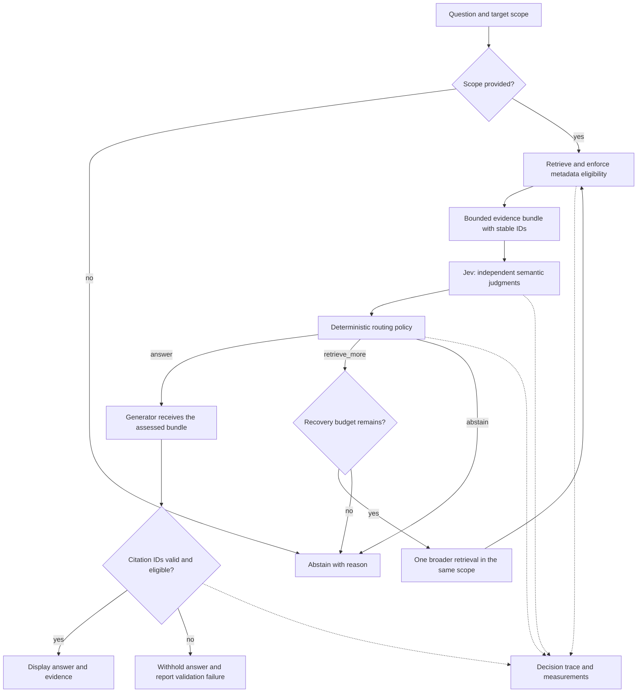

# Architecture

**Status: proposed design.** This repository contains documentation and a scaffold. The components, contracts, and behavior below are not implemented.

EvidenceScope will check whether retrieved documentation can support an answer for an explicit product version and API mode. Its first reference application will use pinned Pydantic V1 and V2 documentation. A reusable library will accept passages from an existing retriever.

## Proposed flow

The `answer` route permits generation. It does not certify the resulting answer; final-answer correctness needs separate evaluation.

## Responsibilities

| Component | Planned responsibility |
| --- | --- |
| Scope and eligibility | Validate target version/API mode; exclude sources known to be incompatible before semantic assessment. |
| Retrieval adapter | Retrieve within the accepted scope and return a bounded bundle. |
| Jev adapter | Judge applicability, sufficiency, and conflicts in supplied evidence. |
| Policy | Apply configured thresholds, reason codes, deadlines, and recovery limits. |
| Generator | Write a cited response using exactly the assessed evidence bundle. |
| Citation validator | Reject nonexistent or ineligible citation IDs; never silently repair them. |
| Inspector and trace | Expose evidence, exclusions, judgments, decisions, failures, and measurements. |

The proposed stack is Python, Pydantic contracts, the official Jev SDK, SQLite FTS5 retrieval, Streamlit, and pytest. Dependency and model versions will be selected and pinned during implementation. Live Jev inference depends on a hosted service; a credential-free recorded demo is planned.

## Evidence and judgments

Each passage will carry a stable ID, source URL, snapshot hash, section location, text, and known version/API applicability. Unknown applicability remains unknown. A migration document can discuss multiple versions within one page, so page metadata alone cannot establish every passage's scope.

Start with at most six passages. Proposed judgments are passage applicability, bundle sufficiency, and pairwise conflict under the same conditions. Different versions or conditions are not automatically contradictions. Six passages permit at most fifteen pair comparisons.

Independent questions may share a state containing the question, scope, and evidence. They must not depend on another question's result. Preserve the full response distributions. A proposition probability and distribution-derived Choice confidence are different quantities; neither is measured correctness. Thresholds will be selected on a calibration split.

Keep the entire eligible bundle for generation in the first implementation. If any passage is removed or changed after sufficiency assessment, reassess the resulting bundle before generation.

## Failure and recovery policy

- Missing target scope: `abstain`, reason `scope_required`, with a clarification message.
- Sufficient applicable evidence without unresolved conflicts: `answer`.
- Insufficient evidence with unused recovery: `retrieve_more`.
- Insufficient evidence after recovery, unresolved conflict, or unavailable judge: `abstain` with a distinct reason.
- Invalid generated citation IDs: withhold the response and record a generation-validation failure.

Recovery will expand retrieval and adjacent sections within the same scope and a fixed token budget. It must add evidence, not repeatedly ask for a different judgment. Permit at most one recovery. Provider errors must never grant permission to answer.

Source text is untrusted data. Input limits, explicit instruction boundaries, and failure handling are necessary, but Jev is not a security boundary. Valid citation IDs establish referential validity, not semantic support.
